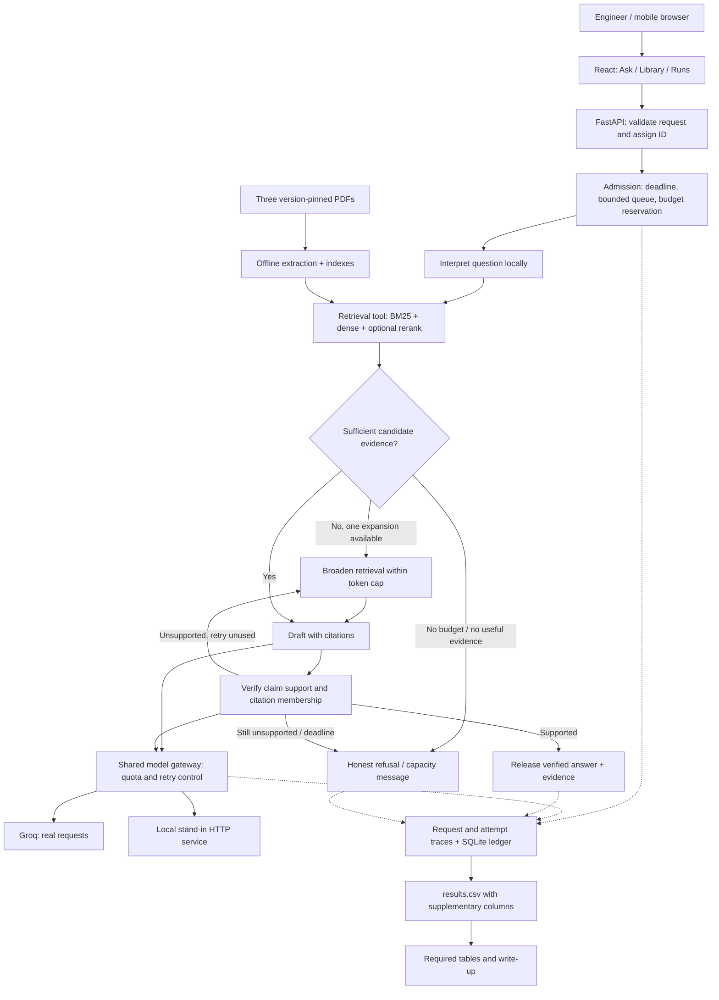

# The Relay — PRD, architecture and delivery plan

Status: Parts 1–5, approved grading, the formal stand-in traffic matrix, Vaani feedback, assistant-use account and visually verified two-page PDF are complete, 13 November 2026. Python backend + React UI were approved by the user during planning. Numeric settings remain proposals unless a cited retained artifact explicitly records a measurement.

Implementation ledger (Part 1): Python 3.12 virtual environment and uv.lock created; exact PDFs downloaded (15/66/39 pages), 435 page-preserving lexical chunks indexed. Initial BM25 retrieval, typed draft/verification pipeline, real Groq streaming adapter, local API and CLI implemented. Ruling: Part 1 uses a clearly named Unicode-word baseline rather than the future embedding-tokenizer settings; simpler setup enables early evidence checks but is not the final retrieval comparison. Ruling: no retries, repair loop, shared budget ledger or public hosting in this slice; max two model calls/request and localhost API only. Those controls remain Part 2/3. After key configuration, two real smoke requests succeeded: a cited Transformer answer (1358.6 ms pipeline time, 2849 input / 220 output tokens) and a Moshi cost-question refusal (584.6 ms, 1409 / 38 tokens). Three total Groq calls, zero retries. Raw request IDs: d44ce5b192524734a79392439ab057fd and 86f2a9bd5f114a1894bdc2492c839764. No broader answer-quality score, user-visible latency, actual limit-trigger or recovery measurement claimed.

Part 1 verification: 33 offline tests pass; Ruff checks pass; localhost HTTP health/library/retrieval and missing-key handling checked. Independent code review found whitespace quote/claim and malformed SSE shape issues; failing regressions reproduced them and the fixes passed the full suite. Minor deferred: capture returned model identity/fingerprint during Part 2 rather than treating requested model ID as observed. Review scope exclusions remain explicit: actual provider quality/limits need credentials; public/load safety and disconnect cancellation need Part 2; full extraction/retrieval quality needs Part 3; UI and final CSV are later deliverables. Local index hashes protect against accidental corruption, not an attacker who can rewrite both data and manifest.

### Part 2 execution ledger — 12 November 2026

User authorized Part 2 in the existing workspace. Implemented persistent budgets,
FIFO admission, deadline/retry policies, calibration and streaming stand-in.
Pre-flight: Pipeline retains the Model contract; ManagedModel owns request retry
state, Budget owns shared atomic accounting, API owns admission. Separate real and
stand-in ledgers prevent synthetic runs from consuming local real allowances.
Returned model/fingerprint capture closes the Part 1 minor follow-up.

Ruling: continue in the user's existing workspace, keep this ledger and avoid extra
worktree/scaffolding files — user requested local continuation and few files; no
committed baseline exists, so the final reviewer reads the working tree.
Ruling: reserve daily draft/verifier allowance upfront but admit minute tokens per
attempt — worst-case two-call estimates can exceed 8K TPM; cost is possible draft
work withheld when verification cannot fit. Never release an unverified draft.
Ruling: persistent rolling 24h local budgets and lower observed ceilings are
conservative protections, not a replica of unmeasured provider replenishment;
cost is possible unnecessary rejection. Token reservations remain labeled heuristics.
Ruling: simulator resamples real echo-prompt timings; load slope/failure cadence
are injected assumptions, replay is plumbing evidence only. Broad retrieval and
formal five-scenario experiments remain Parts 3/5, preserving Part 2 scope.

Real calibration: 12 successful calls, 4,284 input / 324 output tokens, median first
content 483.92 ms / total 485.80 ms. Three samples per size/concurrency cell, no causal
concurrency conclusion. Raw: `runs/calibration-8fadd30233cd4bf49e305085b7217c96.json`.
Initial 12 HTTP 400 attempts plus one diagnostic HTTP 400 remain saved; a missing JSON
word in the calibration prompt was confirmed and fixed with failing regressions
and an early-stop guard. Part 2 total real attempts: 25; including Part 1: 28.
Observed RPD 1000 / TPM 8000; RPM 30 / TPD 200000 remain documented defaults.
No real 429, daily exhaustion, saturation or recovery boundary measured.

Verification: quota/queue/retry/JSON-mode/body-limit/cancellation regressions were
watched fail before fixes. Live loopback test checks incremental SSE and injected
503→200 recovery without hosted calls. Calibrated replay smoke
`cb0d98cf0d774c1997d6979e6e89453a` completed in 961.85 ms, synthetic only.
Independent review: no Critical/Important finding. Reviewer inspected source/tests
and ran two isolated stubbed probes; it was not a formal Codex Security scan or
dependency vulnerability audit. A suspected cross-origin/no-Content-Type bypass
was disproved by the locked FastAPI implementation (422, zero pipeline calls).
Final: minor (deferred): Unicode replay truncation slices characters while synthetic
usage is UTF-8 bytes/3; at tiny output caps this underreports emitted synthetic
tokens. Adapter rejects truncated output, so no answer escapes verification. Fix
before relying on multilingual truncated replay for load-accounting comparisons.
Final: Ruling: actual Groq exhaustion/reset/recovery remains unmeasured — no new
stress calls justified by this small calibration; cost is unknown provider-boundary
behavior, explicitly excluded from measured claims.
Final: Ruling: retrieval quality/verifier reliability/UI/formal load tables remain
later gates — Part 2 is infrastructure, not assignment completion; cost is no
quality or submission-ready claim yet.
Final: Ruling: public/distributed operation and complete dependency audit remain
outside this localhost source review — user-authorized Part 2 scope is single
process; cost is no public production-readiness guarantee.

Part 2 complete: final `.venv/Scripts/python.exe -m pytest -q` → 59 passed in 5.38 s;
Ruff lint and format checks passed. Final-run Windows timing noise exposed an
unstable wall-time difference assertion; the test now checks the stand-in's
explicit scheduled-delay header, while the independent live-socket test checks
incremental delivery. No claimed calibration values changed. Local simulator
started for the HTTP replay smoke was stopped. No deployment, new plugin install,
credential change or hosted load run performed.

### Part 3 execution ledger — 12 November 2026

Implemented the three named configurations from section 4. Setting A retains the
435-chunk word/BM25 index. Settings B/C share 559 exact page spans built with the
pinned MiniLM tokenizer at 220 content tokens / 40 overlap; B fuses BM25 and dense
cosine ranks through deterministic RRF, while C reranks at most 12 fused candidates
with a pinned local CrossEncoder. The 384-dimensional NumPy index and JSONL chunks
are hash-checked; pickle loading and remote code are disabled. Cached query paths
are local-only. Model IDs/revisions and index hashes are in `data/retrieval/manifest.json`.

Ruling: use the planned Apache-2.0 MiniLM bi-encoder/CrossEncoder rather than a
home-grown similarity substitute — this directly evaluates lexical vs dense vs
reranked retrieval; cost is a ~200 MB CPU dependency/model footprint and ~324 ms
median reranked retrieval on this warm candidate run.
Ruling: enforce model limits and fail closed on an overlong query/pair instead of
allowing library-default silent truncation — cost is an operational error for an
extremely token-dense question within the 2,000-character API limit.
Ruling: keep word chunks for A and tokenizer chunks for B/C as the approved table
specified — comparisons are configuration-level, not causal attribution to dense
retrieval alone.
Ruling: one expansion is shared across no-hits/refusal/invalid-citation/verifier
failure; initial k=4/candidates=12 becomes k=6/candidates=24. Maximum two
draft/verify pairs preserves the loop bound; cost is up to four normal model calls.
Ruling: do not run the >=45 real answer evaluation before the user reviews the
questions and preliminary answerability labels — this prevents inventing their
judgments; cost is that Part 3 answer-quality results remain pending.

`docs/evaluation-questions.json` has 18 explicitly assistant-draft questions (15
answerable, 3 unanswerable), status `pending_user`. The retrieval-only harness stores
all 54 ranked results and a SHA256 of that exact set; it neither calls Groq nor assigns
answer grades. Corrected a real metric bug via RED→GREEN: multi-paper recall originally
passed when any expected paper appeared; it now requires all expected papers.

Candidate-only warm results: A 100.0% all-expected-paper recall@4 / 1.96 ms median;
B 93.3% / 13.09 ms; C 93.3% / 324.07 ms. Context medians were 4,377.5 / 3,571.5 /
3,807.5 characters. These assistant-labelled, paper-level results are coarse screening,
not answer correctness. Observed failure examples preserved in the raw output:

1. Multi-paper Moshi/H-Net synthesis: B and C returned four H-Net passages and missed
   Moshi; A included both expected papers. This is the measured recall miss.
2. Transformer positional encoding: C ranked a generic self-attention passage from
   page 2 above the direct positional-encoding section on page 6, though page 6 remained
   in top 4. CrossEncoder ranking is not a support guarantee.
3. Unanswerable probes still retrieve plausible text: Moshi training-cost retrieved a
   safety-score table, and RAG chunk-size retrieved H-Net sequence-model chunking.
   Lexical/dense relevance alone cannot establish answerability; refusal verification
   remains essential.

Official sources inspected: Sentence Transformers retrieve/rerank documentation and
the Hugging Face model cards. `all-MiniLM-L6-v2` was resolved to
`1110a243fdf4706b3f48f1d95db1a4f5529b4d41`; the CrossEncoder was resolved through
the official repository HEAD to `233902d25c440f23af6f7d6e94d2946bac0bee0a`.
Both cards declare Apache-2.0. No model quality superiority was assumed from those cards.

Independent Part 3 review found no Critical issue and two Important issues. Both were
reproduced with failing tests and fixed in one pass: (1) a refused/invalid first draft's
unused verifier hold is released before reserving the second pair, preventing false
daily exhaustion; (2) `serve` loads one shared advanced retriever before Uvicorn starts,
while direct-app fallback loading is synchronized, off-thread and timeout-bound. Focused
tests went RED→GREEN. No hosted calls were used for review or fixes.

Final: minor (deferred): retrieval/model-limit `ValueError` is reported as
`invalid_model_output` by `/api/ask`, while `/api/retrieve` can return an unhelpful 500.
Add stage-specific actionable retrieval errors before UI error-state work.
Final: minor (deferred): page token boundaries can change when the extracted substring
is tokenized alone; 9/559 chunks re-tokenize to 221 content tokens although the source
page window is nominally 220. None approaches 256 or truncates. Validate standalone
lengths and clarify this definition before rebuilding final experiment artifacts.
Final: minor (deferred): retrieval reports bind the question-set hash and full hits but
do not embed lexical/advanced manifest hashes and model revisions. Add fingerprints
before final report generation.
Final: Ruling: hosted answer quality, refusal accuracy and human labels remain pending —
the user must review/revise the draft set before real evaluation; cost is no completed
quality table in this phase.
Final: Ruling: dependency vulnerability certification, public/distributed deployment,
UI and formal load tables remain later scope; cost is no production-readiness claim.

Part 3 implementation gate: final full suite 70 passed in 6.31 s; Ruff lint and format
checks passed. Independent reviewer did not re-review the fixes; each Important finding
has a focused test observed RED→GREEN followed by this green full suite, as required by
the execution workflow. Real end-to-end quality evaluation remains blocked only on the
explicit human review decision above.

## 1. Product and constraints

Build a research-paper assistant for engineers, using only three version-pinned papers. Its distinguishing capability is trustworthy answers and explainable behaviour under constrained model capacity. The first screen must make asking a question and inspecting its evidence obvious. A separate experiments view lets an evaluator inspect real versus simulated runs.

Source of truth: all four pages of the supplied `The_Relay_Assignment_Brief.pdf` were extracted and read. Local workspace has no application files or Git repository; ancestor instruction-file checks found no AGENTS.md. The user has one day; the PDF permits four days, which does not override the user's tighter deadline. UI is additional user scope, not a PDF requirement.

Priority: groundedness and honest evidence, then deadline compliance and reproducibility, then latency and UI polish. We can aim for production engineering practices in a small submission; production readiness, security certification and scalability remain unproven until appropriate verification.

### Acceptance contract

| Requirement | Deliverable / proof |
|---|---|
| Exact library | Fetch 1706.03762v7, 2410.00037v1, 2507.07955v2; manifest records source URL, version, SHA256, retrieval timestamp and page count |
| Python, four steps, tool, branch | Explicit pipeline trace: interpret, retrieve tool, draft, verify; bounded retrieval retry or refusal |
| Cited answers | Paper/version/page/section/chunk IDs; evidence snippets stored in full; citation IDs resolve to retrieved content |
| Groq free service | Real hosted generation and verification through user's account; documented limits separated from measured headers/errors |
| Stand-in | HTTP streaming service with configured slow/failure/429/load-delay behaviours and seed; calibration from real traces |
| Required load cases | steady, burst, sustained overload, per-minute limit halved, daily budget exhausted |
| Retrieval comparison | At least three frozen settings, same question set, preserved answers/evidence/grades/rationale |
| Original questions | User-authored/revised set of at least 15; include unanswerable cases; assistant suggestions explicitly attributed |
| Outputs | runnable code, setup/run commands, results.csv, reproducible tables, supporting traces, <=2-page write-up, authentic conversation/prompts |
| UI | Light, Dark and Black modes; mobile evidence drawer; loading, cancellation, refusal, overload, exhausted-budget and error states |

Non-goals for day one: document uploads, general web search at answer time, multi-tenant SaaS, billing, voice interface, distributed workers, Kubernetes, GraphRAG, fine-tuning, paid services. These exclusions protect the required measurements.

## 2. Source inspection and stack decision

Inspected upstream tree at commit `f67c7dd7a00b887b9ad9d3c9fabf675dd5413d38`, plus complete `document_processing.py`, `rag_pipeline.py`, `schemas/rag.py` and requirements. This is targeted reuse analysis, not a full security audit.

Upstream extraction keeps page numbers and normalizes whitespace. Chunking defaults to 1,100 characters with 160-character overlap. Retrieval supplies source labels and page metadata, and prompt instructions restrict answers to context. The answer path uses Gemini embeddings/generation and Qdrant retrieval, with no independent claim-support verification. Returned excerpts are truncated to 240 characters. PII masking, uploads, tenancy and Supabase integration are outside this assignment's core need.

Retain the ideas of page-aware records, stable IDs, explicit source objects and untrusted-document boundaries. Replace character-only chunks with tokenizer-aware chunks and retain full citation spans. Avoid transplanting the old application's authentication, storage, masking and frontend. No LICENSE file appeared in the inspected tree: public visibility alone is not reuse permission. Until ownership/license is clarified, implement independently and record the reference; do not copy upstream source.

### Alternatives

| Approach | Benefit | Cost / decision |
|---|---|---|
| FastAPI + React + local retrieval | UI control, explicit async policies, few external dependencies | Recommended; requires a small frontend build |
| FastAPI + Streamlit | Fast initial Python UI | Less control over mobile composition and fine-grained streaming states; not preferred for requested UI |
| FastAPI + React + Qdrant server + distributed queue | Useful for larger shared corpus and multiple workers | Extra services and quota coordination without benefit demonstrated for three papers; defer |

### Recommended components

| Layer | Choice | Reason / boundary |
|---|---|---|
| Runtime | Python 3.12 proposed, uv, lockfile | Stable dependency compatibility; local system currently has Python 3.10 and uv; verify/install compatible runtime during implementation |
| API | FastAPI, Pydantic, Uvicorn | Typed schemas and async I/O; one process initially |
| Provider | HTTPX async streaming adapter to Groq | Direct headers/error/timing capture; one explicit retry owner |
| Pipeline | Small typed Python state machine | Four bounded stages are readable without an orchestration framework |
| PDF | pypdf first; targeted extraction review | Preserve page/section/span identity; inspect columns, formulas and tables; change parser only where evidence warrants |
| Retrieval | BM25 + Sentence Transformers embeddings + NumPy cosine search; RRF fusion | Small corpus allows exact local search and avoids vector-service credentials |
| Optional rerank | Local cross-encoder on bounded candidates | Test quality benefit against CPU delay; no hosted reranking calls |
| Persistence | SQLite + JSONL traces + CSV export | Atomic local budget ledger, runs, answer artifacts; inspectable evidence |
| Browser | React + TypeScript + Vite | Approved; static production build can be served by FastAPI under one origin |
| UI foundations | CSS semantic tokens, accessible primitives as needed, Lucide icons | Light/Dark/Black without a large UI framework or unnecessary components |
| Checks | pytest, Ruff, type checking, browser workflow/accessibility checks | Focus on quota races, cancellation, grounding, export and mobile behaviour |

Package/model revisions will be pinned after compatibility checks, not guessed from old requirements. Local embeddings/reranking are free model computation; all hosted model calls use Groq. Model candidate: `openai/gpt-oss-20b`, with `openai/gpt-oss-120b` considered only if measured quality warrants it. These are candidates from current official catalog, not benchmark winners. Confirm actual account access before fixing the experiment model. Do not switch models/accounts to bypass limits.

## 3. Architecture and trust boundaries

Loop guard is shared across evidence expansion and verification repair: at most one additional retrieval and at most two draft/verify pairs. Every model attempt passes the same gateway; no helper bypasses accounting. Ordinary request uses two model calls (draft + verify); interpretation and retrieval are local. Verification failure never becomes permission to return an unverified draft. Syntactic citation validation is deterministic; semantic support checking remains fallible and is evaluated by human review.

Data contracts: `QuestionRequest(question, retrieval_setting, client_request_id)`; `Evidence(paper_id, version, page, section, chunk_id, text, score)`; `Answer(text, claims, citation_ids, disposition)`; `ModelAttempt(request_id, stage, attempt, timing, usage, headers, outcome)`.

Suggested API: `POST /api/ask` with streamed progress/final events; `GET /api/library`; `GET /api/runs`; `GET /api/runs/{id}`; `GET /health`. Experiment generation is a local CLI, not a public browser button. Caller-supplied source URLs or arbitrary tool names are not accepted. IDs resolve server-side to the pinned library.

UI receives progress immediately. Draft token streams stay internal until verification completes. Mandatory `first_token_ms` measures first user-visible answer/refusal content, not progress events or internal model tokens. Capture provider TTFT separately per call. Verified buffered text can be delivered in one final payload; never pretend artificial character animation is provider streaming. Stand-in and real model adapters still consume true streamed chunks and record their arrival times.

## 4. Retrieval experiment

Start with an Apache-2.0 MiniLM embedding candidate and verify its tokenizer limit. Never silently truncate a long chunk. Sizes below are proposed tokenizer content-token budgets with special-token headroom; final manifests record tokenizer/model revisions.

| Setting | Child size / overlap | Retrieval | Rerank | Answer context cap |
|---|---|---|---|---|
| A lexical baseline | 180 / 30 | BM25 top 4 | No | 900 tokens |
| B hybrid | 220 / 40 | BM25 + dense, RRF, top 4 | No | 1,100 tokens |
| C hybrid + rerank | 220 / 40 | Fused top 12 -> top 4 | Yes | 1,100 tokens |

Preserve paragraphs/section labels where possible; prevent overlap duplicates from consuming the whole context. Optional bounded adjacent-span expansion is a later measured ablation, not an unreported change. These three settings jointly change retrieval technique and, for A/B, chunk size: report them as configurations, not causal proof of which individual component helped.

Run the same >=15 questions under all three settings: at least 45 end-to-end real answer requests if budget permits, normally >=90 provider calls because verification is counted. Reserve budget for calibration and failures first; spread calls across minutes. Keep model/prompt, output cap and grading rubric fixed; interleave settings to reduce time-of-day confounding. Separate exploratory questions from frozen evaluation questions where practical. Retain answer text, selected passages, expected evidence, grades and rationale; ask the user to review disputed judgments. Do not treat similarity or verifier scores as probabilities of correctness.

Proposed failure probes (not observed failures yet): (1) confusing the Dynamic Chunking paper's sequence modelling with RAG document chunking; (2) attributing Moshi's streaming latency to Transformer training/inference generally; (3) retrieving an attention equation while losing its definition, table header or qualification. Concrete questions and true failure examples must be grounded in the fetched versions and observed retrieved passages.

Near a limit, reduce candidate context only through an explicitly logged degraded setting; retain the support verifier. Prefer shorter supported answers or a capacity refusal over skipping grounding. Reranking is local and does not itself consume Groq request budget, although it consumes time.

## 5. Reliability policies and measurements

Initial test policy, subject to calibration: two concurrent provider calls, FIFO request queue capacity eight, queue wait cap 5 seconds, overall request deadline 30 seconds. Connect timeout 3 seconds and stream inactivity timeout 10 seconds sit inside the end-to-end deadline. Local retrieval deadline initially 3 seconds, with model warmup excluded from warm-run timings and recorded separately. Run blocking embedding/reranking work outside the async event loop with bounded workers.

Provisional quiet-load targets: p95 verified first content <=8 seconds and p95 total <=12 seconds. These are targets, not results or promises. Correctness takes priority if they conflict. Under overload, bounded admission and explicit rejection are acceptable; measure their frequency.

Retry only retryable transport errors, 429 and selected 5xx; at most one retry per model call and two retry attempts total per user request, all within deadline and quota. Honour Retry-After, otherwise bounded exponential backoff with jitter. Never retry authentication/validation failures. Daily exhaustion is terminal for generation. Do not start fresh attempts after user cancellation; release unspent reservations, but count work already dispatched. Retry experiments include a seeded slow-success case that causes duplicate expensive work, with retry-on versus retry-off comparison.

Before drafting, atomically reserve capacity for both the draft and mandatory verifier, including their estimated input and capped output tokens. A request that cannot reserve this normal pair waits only within its queue deadline or receives a capacity denial. Repairs/retries need additional reservations within the same deadline; they cannot spend another request's reserved verifier capacity. Reconcile with actual usage and conservatively retain uncertain usage after interrupted streams. Distinguish usage missing from zero. Persist daily accounting across restarts. Groq budget may be shared with other activity; headers/account console can supersede local estimates. Do not assume local midnight matches provider reset. Unknown reset time is shown honestly.

Daily exhaustion copy: “Today's model budget is used up. I can't generate a verified answer right now. You can still read the three papers and inspect available passages. Please try again after the budget resets.” Add a reset time only if supported by observed/provider data. Existing queued work without sufficient reserved budget is ended promptly; already-dispatched work is accounted for. Capacity refusal is not an evidence-based refusal grade.

Stand-in service uses the same HTTP streaming contract and fixtures from retained real answers. Model startup time and inter-chunk delays can be sampled from measured distributions; configured failure/429 probabilities and load-dependent delay are explicitly synthetic where not calibrated. Seed and profile are recorded. Replay can evaluate system behaviour, not new answer quality. Synthetic token estimates and real usage are labelled separately. Do not infer true provider saturation from this simulator.

Calibration: begin with 12-20 modest real calls spanning short/long prompts and bounded concurrency 1/2. Store headers, actual model ID, timestamps, lengths, token usage and errors. If appropriate under published terms, use a strictly capped short boundary probe, stop at first 429 and record recovery; do not exhaust daily budget intentionally. If no real limit is observed, report “not measured” and do not invent it. Account-specific headroom may require fewer calls. Revisit calibration after longer runs; small samples cannot establish stable p99.

Load generation is open-loop, scheduled independently of completions, so a slow service does not silently reduce offered load. Record scheduled arrival, actual dispatch, run window, drain deadline, and generator lag. Proposed stand-in scenarios: steady at 0.5x estimated sustainable arrival rate for 120s; burst of 20 simultaneous arrivals; overload at 2x sustainable rate for 120s; same steady schedule with configured RPM and TPM halved; daily budgets initially exhausted. These are inputs; observed service capacity and final request counts determine final configurations. State which limits were halved. Include one modest real steady run; heavy scenarios use stand-in.

## 6. Evidence schema and report contract

Mandatory CSV columns, unchanged:

`request_id, scenario, source, start_time, first_token_ms, total_ms, status, retries, tokens_in, tokens_out, retrieval_setting, answer_grade`

Exact enums: source = `real | stand-in`; status = `ok | rate_limited | timeout | error`; answer_grade = `correct | wrong | refused_correctly | refused_wrongly`. Scenario labels proposed: `steady`, `burst`, `sustained_overload`, `minute_limit_halved`, `daily_budget_exhausted`; PDF does not prescribe their exact spelling.

Important ambiguity: transport failures have no answer to grade, but the PDF gives no ungraded enum. Proposed transparent convention: empty answer_grade for non-answer transport outcomes, plus `grade_applicable=false`; exclude them from quality denominators and include them in outcomes. This needs evaluator clarification if their CSV validator prohibits empty cells. Never label a network error as a correct refusal. Same treatment for capacity denials that make no evidence judgment.

The PDF requires every table figure to be recomputable from results.csv, although the listed columns alone cannot encode queue peak, run duration or limit discovery. Preserve mandatory columns first and append: `run_id, record_kind, question_id, grade_applicable, usage_known, token_usage_source, refusal_reason, outcome_reason, given_up, run_duration_s, offered_count, offered_rate_per_min, peak_queue_length, queue_ms, working_ms, retry_wait_ms, provider_first_token_ms, model_id, config_hash, seed, cost_usd, cost_basis, limits_json, limits_evidence_json`. Repeat run-level metadata consistently on its request rows and validate consistency. Store recorded limit observations/confidence in the limit fields on actual probe request rows, not fabricated zero-request records. Detailed event JSONL supports auditing, but tables use CSV columns only. If exactly-only columns are required by an external validator, ask the evaluator to resolve the conflicting requirement; supplementary-only traces would not satisfy the literal PDF statement.

Percentiles: nearest-rank p50/p95/p99, report sample size and eligible count. TTFT uses only requests with visible content; total-time results include terminal outcomes, with success-only breakdown supplementary. Never set missing TTFT to zero. Outcome denominator is all offered requests recorded by harness, including admission rejection. Status percentages are mutually exclusive; timeout includes explicit abandonment with a distinguishing field. Tokens per answer = total known consumed tokens including retries divided by delivered answers, accompanied by coverage of known usage; also report per-request tokens for quality runs. Requests versus model calls must remain distinct. Cost/1,000 answers uses actual free-tier spend (zero only when verified free usage); simulated runs are labelled as simulated cost basis, not real billing. If unknown, write “not measured”.

Required tables: (1) RPM, TPM, RPD, TPD, requests in flight, limit response, recovery time, with value/evidence/confidence; (2a) scenario/source/count/duration/offered rate/TTFT p50-p95-p99/total p50-p95-p99; (2b) success/rate-limit/timeout-or-given-up percentages, retries/request, peak queue, tokens/answer, cost/1,000; (3) setting, questions, correct-and-cited/wrong/correctly-refused percentages, tokens/answer, TTFT p50-p95 and total p50-p95. Preserve wrong-refusal counts in CSV and supporting analysis even though Table 3 lacks its own column. Percentages use one decimal, time uses ms.

Decision log, 12 November 2026: the user reviewed the 18-question assistant draft and replied “done” after being asked to approve the set or list changes. This is recorded as question-set approval, not as user authorship. End-to-end cases are checkpointed after every outcome. Only `status=ok` with an answered or evidence-refused disposition completes a quality case; operational failures remain reproducible attempts and are retried by a later batch. Human grades and grading rationale remain blank until separately reviewed.

Real quality checkpoint, 12 November 2026: 42/54 cases completed, covering 14 questions with all three settings; 48 total records preserve 5 local minute-budget outcomes and 1 local daily-budget outcome. Completed dispositions are 22 answered and 20 refused. This is not a quality result because 0/48 records have a human grade. The fifteenth question was retrieved but its draft pair reservation was rejected before provider access at 192,038/200,000 rolling local tokens. Resume after ledger capacity expires; never delete or increase the ledger merely to make the experiment appear complete.

For Table 3, each quality percentage uses completed graded answers as its denominator, explicitly labelled in the table note, and every row additionally shows graded/attempted coverage. “Questions asked” counts all scheduled evaluation questions, not just successes. Report end-to-end useful-answer rate over all attempted questions alongside the quality table, so capacity loss cannot improve a setting's apparent success. Failed/ungraded rows remain in the CSV and outcome tables. Retrying an evaluation question creates a new request ID linked to the question ID; it never replaces the failed record. The final CSV compliance claim remains blocked on the ungraded-value ambiguity until clarified.

Exact write-up heading order:

1. What I built and why.
2. The real service and my stand-in.
3. Results.
4. Where the time goes.
5. When a limit is hit.
6. Retrieval: quality versus cost.
7. How this library will mislead a naive retriever.
8. Retries.
9. What the person sees.
10. What I'm unsure about, what I left out, what I learned.
11. Your feedback on Vaani.
12. How I worked with the assistant.

The final heading includes the required half-page reflection within the two-page writing limit; authentic conversation history is a separate attachment. Tables also fit in the two-page write-up. This is tight: produce the layout early, use concise prose and readable tables, and report “not measured” instead of omitting required cells. No invented personal learning, caught mistake or overruled decision. User must supply authentic reflection. Preserve original prompts unchanged in the conversation export; this PRD's refined prompt is a new assistant-authored prompt, not replacement history.

## 7. UI direction

Original research workspace informed by Linear's reduced visual noise and Geist's typography and contrast. These are references available today, not proof of a universal “2026 trend.” Avoid copying logos or claiming affiliation.

Desktop: compact left navigation (Ask, Library, Runs), readable central question/answer column, evidence side panel only when needed. Initial title: “Ask questions about three research papers.” Show the library and a few genuine question examples. One primary Ask action. No marketing hero, decorative KPI cards, purple gradients, fake charts or unrelated controls.

Mobile: single-column question and answer; navigation collapses; tapping a citation opens a labelled bottom sheet with paper/page/excerpt and original-PDF link. Preserve draft text across panel changes, show Cancel during requests, keep keyboard focus predictable. A citation shows exactly the passage used, not only a paper title.

| Theme | Main background | Surface | Primary text | Accent |
|---|---|---|---|---|
| Light | #FFFFFF | #F5F5F5 | #171717 | #1D4ED8 |
| Dark | #151515 | #202020 | #F5F5F5 | #93C5FD |
| Black | #000000 | #0A0A0A | #F5F5F5 | #93C5FD |

These are proposed tokens; verify contrast for actual combinations. Black means a true #000000 main canvas, with borders/elevated surfaces for separation. System preference initializes Light/Dark; Black is explicit and persisted. Use self-hosted/system sans typography, 16px answer text, comfortable line-height and approximately 70-character reading width. Smaller utility labels must stay legible. Eight-pixel spacing rhythm, restrained radii, consistent icon strokes, reduced-motion support and 44px touch targets. WCAG 2.2 AA is a verification target, not a certification claim.

States: empty, retrieving, waiting for model capacity, drafting internally, checking evidence, answered, evidence-insufficient, cancelled, overloaded, daily exhausted, connection lost. Do not expose raw stack traces or fake percentage completion. Runs view clearly separates real/stand-in and observed/configured values; technical metrics belong there rather than dominating Ask.

Approved execution direction for Part 4: React + TypeScript + Vite over the existing FastAPI API, with plain CSS tokens and no frontend framework duplication. The desktop and mobile production-spec concepts are preserved at `docs/ui/relay-desktop-concept.png` and `docs/ui/relay-mobile-concept.png`. Desktop uses the Light answered state with an open evidence rail; mobile uses true Black with a citation bottom sheet. These generated concepts are layout references, not shipped raster UI. Browser implementation comparison remains pending.

## 8. Security and operations

Trust boundaries: user question and extracted paper text are data; neither can change system policies, execute commands or introduce external URLs/tools. Validate all citation IDs against current retrieved evidence. Server-side Groq key in ignored `.env`; never browser-bundle it or print authorization headers. Sanitize Markdown/links, forbid raw HTML, enforce request length and body limits, restrict CORS/origins, and redact secrets from logs.

Default localhost binding and one Uvicorn worker preserve single-owner admission control. A public deployment is a separate release condition: HTTPS, authenticated access, abuse limits, secret handling, dependency checks, persistent accounting and verified shared-budget design if using multiple workers. Do not put an unrestricted paid-capability endpoint on the Internet. No arbitrary uploads or network-fetch tools reduce attack surface for this fixed library.

Tests target prompt-injection boundaries, invented citation IDs, numerical claims without evidence, malformed streaming events, retry amplification, queue overflow, concurrent token reservation, restart budget persistence, client disconnects, unsafe Markdown and export reproducibility. Security design is not evidence of a completed audit.

## 9. Five delivery parts

Timeboxes are planning estimates for focused work, not guarantees. Total approximately 11 hours plus contingency; credentials and human review can extend elapsed time.

| Part | Timebox | Scope and exit evidence |
|---|---|---|
| 1. Corpus + minimal vertical slice | 2h | Locked setup, exact PDFs, extraction spot checks, source records, lexical retrieval, one real cited answer path and trace |
| 2. Provider control + stand-in | 2.5h | Shared gateway, queue/deadlines/retries/budgets, real calibration, streaming simulator, deterministic policy tests |
| 3. Retrieval + grounded pipeline | 2h | Three settings, bounded verification loop, reviewed question set, answer/evidence/rationale persistence, quality runs begin |
| 4. Responsive UI | 1.5h | Ask/Library/Runs shell, citations, three themes, genuine loading/error/cancel states; desktop/mobile checks |
| 5. Experiments + submission | 3h | Five load scenarios, raw CSV reconciliation, slow-request and retry case, required tables, two-page PDF, user reflection/history |

Create only useful modules: `src/relay/{api,config,corpus,retrieval,pipeline,provider,policy,simulator,experiments,reporting}.py`, a CLI entry point and shared schemas where needed; focused tests; `web/src` with shell, Ask, Evidence, Runs and theme styles; `data` for corpus/indexes; `runs` for evidence; `docs` for the present plan and final submission. This is a responsibility map, not permission to generate empty placeholder files.

Proposed future commands (not runnable until implemented): `uv sync`; `uv run relay ingest`; `uv run relay calibrate`; `uv run relay serve`; `uv run relay simulate`; `uv run relay evaluate`; `uv run relay load --scenario all`; `uv run relay report`; `uv run pytest`. Actual README must contain verified Windows PowerShell commands and working-directory requirements, plus frontend build commands. No manual installation required during planning.

## 10. Tools already available and manual work

Verified GitHub connector works by reading upstream files. Plugin search reports GitHub, Figma, Sites and Product Design installed. Runtime tool catalog exposes browser/computer-use, document/PDF tooling, Node runtime, Supabase/Vercel and Codex Security; installed/exposed does not prove every account connection is healthy. Local Codex TOML contains a node_repl MCP entry; plugin-managed capabilities can exist outside that file. No configuration secrets were printed.

Selected skill bundles available locally: Superpowers, Build Web Apps, UI UX Designer, Product Design, Figma, Plugin Management, Codex Security and Writing Style. Writing Style search/retrieve actions were not exposed in this session; use supplied prose and explicit language preferences without claiming a retrieved personal style match. Figma is optional for design handoff; Sites supports static/Worker hosting and is not assumed to host this Python service. Neither requires new installation for planning. Account safety-settings controls parental/trusted-contact settings; it is unrelated to application security and is left untouched.

Required new MCP servers: none. Groq is a backend API dependency, not a required MCP server. Existing web research, GitHub and browser tooling cover current needs. Add no extra servers until a concrete missing capability appears. Do not install duplicate Playwright/GitHub/filesystem tools merely to increase tool count. Security review should happen against actual implementation later.

User tasks: (1) put a Groq free key in local ignored `.env` when template exists; share no key in chat, (2) confirm upstream code ownership/reuse rights if literal copying is desired, (3) author/revise the >=15 questions and review grades/tradeoffs, (4) inspect Vaani personally and provide feedback, (5) preserve/export actual conversation and provide authentic learning, caught-error and overrule examples. Optional public hosting requirements can be decided after the measured local submission works.

Vaani observation from page text only: the site promotes a voice-AI harness and offers both a film and live-call entry. “Harness” may be less clear to a new user than a concrete business outcome; a short three-step explanation could help. This is an assistant observation, not the user's feedback, and no live-call/audio usability test was performed.

## 11. Refined working prompt

> Research and plan The Relay in this workspace before implementing. Treat the original four-page assignment PDF as the requirements authority, and flag ambiguities rather than silently changing them. Build a Python pipeline with a React/TypeScript responsive UI, Groq free-tier hosted model calls, and the exact three paper versions. Prefer a small explicit architecture that can be measured and defended within one day. Compare current official sources and explain stack tradeoffs; newer technology is useful only when it improves this workload. Propose and evaluate at least three retrieval settings, a bounded retrieval/draft/verification pipeline, and explicit admission, timeout, retry and minute/day-budget policies. Design a calibrated streaming stand-in and preserve real and synthetic evidence separately. Deliver reproducible CSV-driven tables and the required two-page write-up with authentic human contributions. Use a clean original research-workspace interface with Light, Dark and true Black themes, accessible typography, citations and complete mobile/error states. Inspect existing code and tooling first; reuse code only with appropriate rights. Keep dependencies and files purposeful. Produce a PRD, architecture diagram and at most five delivery parts, identify manual actions, and never fabricate measurements, test results, personal decisions or conversation history. State proposals, measured facts and unresolved questions distinctly.

## References inspected

- Assignment PDF: local original, pages 1-4, fully read.
- Upstream source: https://github.com/Parth7881/RAG-Document-BeFree/tree/f67c7dd7a00b887b9ad9d3c9fabf675dd5413d38
- Groq limits/headers: https://console.groq.com/docs/rate-limits — account limits can differ; request headers refer to daily requests, token headers to minute tokens. No account limits measured yet.
- Groq model catalog: https://console.groq.com/docs/models — candidate availability must be checked with the account.
- Async API: https://fastapi.tiangolo.com/async/
- HTTP timeouts: https://www.python-httpx.org/advanced/timeouts/
- Bounded queue: https://docs.python.org/3/library/asyncio-queue.html
- Retrieval/rerank: https://sbert.net/examples/sentence_transformer/applications/retrieve_rerank/README.html
- Embedding candidate: https://huggingface.co/sentence-transformers/all-MiniLM-L6-v2
- Frontend build: https://vite.dev/guide/
- UI reference: https://linear.app/now/how-we-redesigned-the-linear-ui (2024 article, not a 2026 trend report)
- Design system: https://vercel.com/geist/introduction
- Accessibility: https://www.w3.org/TR/WCAG22/
- Security reference: https://owasp.org/projects/top-10-for-large-language-model-applications
- Vaani: https://www.vaani.dev/
